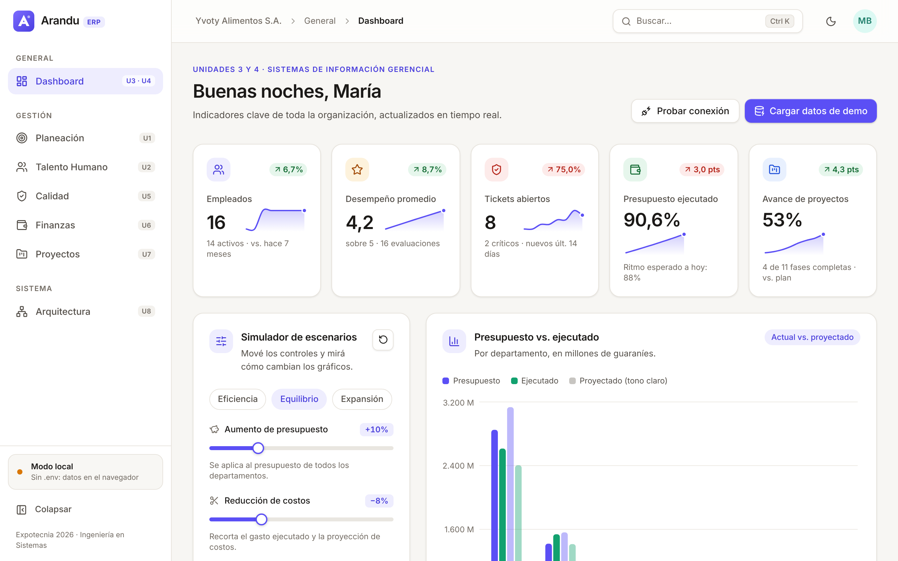
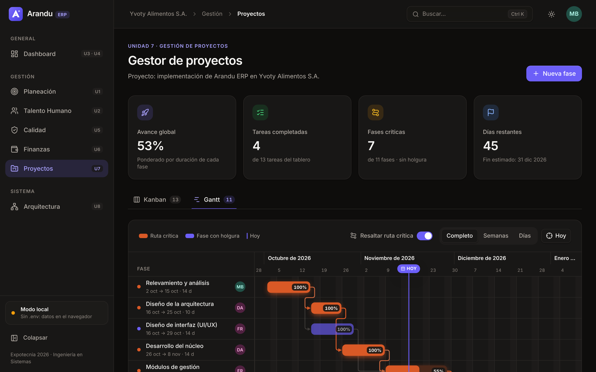

# Arandu ERP · Expotecnia

ERP simplificado para la feria **Expotecnia** (Ingeniería en Sistemas). Siete módulos integrados sobre una misma base de datos en tiempo real, con una interfaz moderna en modo claro y oscuro.

> *Arandu* significa «sabiduría» en guaraní. El nombre se cambia en un solo archivo: `src/config/brand.js`.




## Módulos

| Módulo | Unidad | Ruta | Qué muestra |
| --- | --- | --- | --- |
| Dashboard | 3 y 4 | `/` | KPIs animados, 4 gráficos, **simulador de escenarios** y actividad en tiempo real |
| Planeación Estratégica | 1 | `/planeacion` | Matriz FODA editable; se pueden agregar, editar y eliminar empresas |
| Talento Humano | 2 | `/talento-humano` | Empleados (ABM), evaluación de desempeño con estrellas, encuesta de clima paso a paso |
| Calidad y Mejora Continua | 5 | `/calidad` | Kanban de no conformidades con drag & drop + vista tabla con filtros |
| Finanzas | 6 | `/finanzas` | Presupuesto vs. ejecutado en Guaraníes, totales y alertas de exceso |
| Gestor de Proyectos | 7 | `/proyectos` | Kanban de tareas y Gantt propio con dependencias y ruta crítica |
| Transformación Digital | 8 | `/arquitectura` | Diagrama animado del stack y ciclo de vida del sistema |
| Usuarios | — | `/usuarios` | Alta, edición y baja de usuarios, roles y cambio de usuario |
| Documentación | — | `/documentacion` | Guía de uso y documentación técnica dentro del propio sistema |

> **Documentación completa**: está en el sistema (menú lateral → *Documentación*) y también como archivo en [`docs/DOCUMENTACION.md`](docs/DOCUMENTACION.md). Se edita en `src/modules/documentacion/contenido.js` y el archivo se regenera con `npm run docs`.

## Stack

React 19 + Vite · React Router · Firebase Firestore (`onSnapshot`) · Tailwind CSS 4 · Recharts · Framer Motion · lucide-react · @hello-pangea/dnd

---

## 1. Instalación

Requisitos: **Node.js 20.19 o superior** (recomendado 22) y npm.

```bash
git clone <url-del-repositorio>
```

```bash
cd erp-expotecnia
```

```bash
npm install
```

## 2. Correr el proyecto

```bash
npm run dev
```

Abrí <http://localhost:5173>. Siempre aparece la pantalla de acceso: ingresá con un correo `nombre.apellido@gmail.com` (por ejemplo `nicolas.batta@gmail.com`, Administrador) y la contraseña de demostración **12345678**. El botón **Cuentas de la demostración** lista todos los correos.

El servidor también queda visible en la red local (`Network: http://192.168.x.x:5173`), así que podés abrirlo desde un celular conectado al mismo wifi: ideal para mostrar el tiempo real en la feria.

Otros comandos:

```bash
npm run build
```

```bash
npm run preview
```

```bash
npm run build:demo
```

`build:demo` genera **`dist-demo/arandu-erp.html`**: toda la app en un único archivo que se abre con doble clic, sin servidor ni Firebase (guarda los datos en el navegador). Sirve para compartir la demo. Ojo: el `index.html` de la raíz **no** se puede abrir con doble clic (queda en blanco), porque necesita `npm run dev`.

```bash
npm run docs
```

`docs` regenera `docs/DOCUMENTACION.md` desde el contenido de la documentación del sistema.

### Modo local (sin Firebase)

Si todavía no existe el archivo `.env`, la app **funciona igual**: guarda los datos en el navegador (localStorage) y sincroniza entre pestañas. Los datos de demo no se cargan solos: un Administrador toca **Cargar datos de demo**. El sidebar lo indica con la etiqueta **Modo local**. Sirve para desarrollar y como plan B si se cae el wifi en la feria.

## 3. Configuración de Firebase

1. Entrá a <https://console.firebase.google.com> → **Agregar proyecto**. Poné un nombre y **desactivá Google Analytics** (no hace falta).
2. En la página principal del proyecto tocá el ícono **`</>` (Web)** para registrar una app web. No marques Firebase Hosting. Al terminar, la consola muestra el objeto `firebaseConfig`.
3. En la raíz del proyecto, copiá el archivo de ejemplo:

   ```bash
   cp .env.example .env
   ```

4. Pegá en `.env` cada valor de `firebaseConfig`:

   | `firebaseConfig` | Variable en `.env` |
   | --- | --- |
   | `apiKey` | `VITE_FIREBASE_API_KEY` |
   | `authDomain` | `VITE_FIREBASE_AUTH_DOMAIN` |
   | `projectId` | `VITE_FIREBASE_PROJECT_ID` |
   | `storageBucket` | `VITE_FIREBASE_STORAGE_BUCKET` |
   | `messagingSenderId` | `VITE_FIREBASE_MESSAGING_SENDER_ID` |
   | `appId` | `VITE_FIREBASE_APP_ID` |

5. En la consola: **Compilación → Firestore Database → Crear base de datos**. Elegí la ubicación **`southamerica-east1` (São Paulo)** y **Comenzar en modo de prueba**.
6. Reiniciá `npm run dev` (Vite lee el `.env` solo al arrancar).
7. En el Dashboard tocá **Probar conexión**: escribe un documento en `test_collection` y confirma con un aviso. Después tocá **Cargar datos de demo**.

El sidebar muestra el estado real de la conexión: *Conectando…*, *Firestore · en vivo*, *Sin conexión* o *Error de Firestore*.

> **Importante:** las reglas del *modo de prueba* vencen a los 30 días. Si Firestore empieza a rechazar lecturas («permission-denied»), entrá a **Firestore → Reglas** y extendé la fecha. Para la feria alcanza con esto (no dejar así en producción: cualquiera con la URL puede leer y escribir):
>
> ```
> rules_version = '2';
> service cloud.firestore {
>   match /databases/{database}/documents {
>     match /{document=**} {
>       allow read, write: if request.time < timestamp.date(2027, 1, 31);
>     }
>   }
> }
> ```

El archivo `.env` no se sube al repositorio (está en `.gitignore`). Cada integrante crea el suyo con los mismos valores.

No hay autenticación real por ahora. La sesión simulada vive en `src/context/SessionContext.jsx`; cuando se sume Firebase Auth, ese es el único archivo a reemplazar.

## 4. Usuarios y empresas

- **Ingreso**: correo + contraseña. La sesión dura mientras la pestaña está abierta (no se restaura al volver a abrir la app). Los usuarios base están en `src/config/usuarios.js` y se crean en Firestore los que falten al abrir la app, aunque no se hayan cargado los datos de demo.
- **Cuentas**: equipo (Nicolás Batta Piccinini, Wilson Bogado, Bethania Benítez, Jazmín Benítez, Augusto Benítez, Isaías Colmán) y los usuarios de la empresa de ejemplo. Todos con correo `nombre.apellido@gmail.com` y contraseña de demostración `12345678`. El rol de los nuevos integrantes se cambia en `ROL_USUARIOS_NUEVOS`.
- **Cambiar de usuario**: menú del avatar → *Cambiar de usuario* (sin pasar por el ingreso), o el botón de flechas en la página *Usuarios*.
- **Gestionar usuarios** (solo Administrador): página *Usuarios* → crear, editar rol/estado o eliminar. Reglas: correo único, no se puede borrar el propio usuario y siempre queda al menos un administrador activo.
- **Contraseñas**: obligatorias al crear un usuario; se guardan solo como hash SHA-256. Es un **control de acceso de demostración en el cliente, no seguridad real**: para producción hay que usar Firebase Authentication y reglas de Firestore.
- **Roles**: Administrador, Editor y Lector. Por ahora el rol solo controla la gestión de usuarios; el resto de los permisos requiere autenticación real y reglas de Firestore (ver la documentación del sistema).
- **Empresas** (Planeación): *Nueva empresa* en la cabecera; el lápiz de la tarjeta edita y, desde la edición, se elimina (también borra su matriz FODA).

## 5. Datos de demo y utilidades

| Acción | Dónde | Qué hace |
| --- | --- | --- |
| **Cargar datos de demo** | Dashboard, menú del avatar y estados vacíos (solo Administrador) | Escribe más de 200 documentos realistas (empresa ficticia *Yvoty Alimentos S.A.*). Los ids son fijos: volver a tocarlo restablece los datos sin duplicar |
| **Probar conexión** *(temporal)* | Dashboard y menú del avatar | Escribe en `test_collection` y espera la confirmación del servidor |
| **Vaciar datos de los módulos** | Menú del avatar | Borra los registros de los módulos (pide confirmación). Conserva usuarios y empresas |
| **Buscador** | `Ctrl + K` / `⌘ K` | Busca páginas, empleados, no conformidades y tareas |

Las fechas del seed son relativas al día en que se carga, así el Gantt siempre tiene la línea de «hoy» en el medio del proyecto.

---

## Estructura del proyecto

```
src/
├─ firebase/
│  ├─ config.js        Inicializa Firebase con las variables VITE_FIREBASE_*
│  ├─ hooks.js         useCollection (onSnapshot) + add / update / remove
│  ├─ localStore.js    Almacén local de respaldo (modo sin .env)
│  └─ seed.js          Datos de demostración
├─ components/
│  ├─ ui/              Button, Card, Badge, Modal, Input, Select, Table, Tabs, Toast,
│  │                   Skeleton, EmptyState, Avatar, ProgressBar, StatCard, ThemeToggle…
│  ├─ layout/          Sidebar, Header, PageHeader, Layout, buscador
│  ├─ charts/          Tooltip, leyenda y estilos compartidos de Recharts
│  └─ kanban/          Tablero Kanban genérico (lo usan Calidad y Proyectos)
├─ modules/            UNA CARPETA POR MÓDULO
│  ├─ dashboard/  planeacion/  talentoHumano/  calidad/  finanzas/
│  ├─ proyectos/  arquitectura/  usuarios/  documentacion/  login/
├─ config/             Marca, navegación y catálogos (departamentos, prioridades, colecciones)
├─ context/            Tema (claro/oscuro) y sesión simulada
├─ lib/                Formato (Gs., fechas), animaciones, utilidades
├─ index.css           Tokens del sistema de diseño
├─ App.jsx             Rutas
└─ main.jsx
```

## Cómo leer y escribir datos

Todos los módulos usan el mismo hook. Los cambios llegan solos a todas las pantallas abiertas:

```jsx
import { useCollection, logActivity } from '@/firebase/hooks'
import { COLECCIONES } from '@/config/constants'

function Ejemplo() {
  const { data, loading, error, add, update, remove } = useCollection(COLECCIONES.empleados, { orderBy: 'nombre' })

  const crear = () => {
    add({ nombre: 'Ana Fernández', cargo: 'Analista', departamento: 'Finanzas' })
    logActivity('Talento Humano', 'dio de alta a Ana Fernández', 'crear') // aparece en el feed del dashboard
  }
  // update(id, { cargo: 'Jefa' })   ·   remove(id)
}
```

- Mientras `loading` es `true` se muestra un *skeleton*; si la lista está vacía, un `EmptyState`.
- Las escrituras son optimistas (la pantalla se actualiza al instante). Si Firestore rechaza una, aparece un toast de error automáticamente.

### Colecciones de Firestore

| Colección | Módulo | Campos principales |
| --- | --- | --- |
| `empresas` | Planeación | `nombre`, `rubro`, `ciudad`, `descripcion` |
| `foda` | Planeación | `empresaId`, `tipo`, `texto` |
| `usuarios` | Usuarios | `nombre`, `email`, `cargo`, `rol`, `estado`, `ultimoAcceso` |
| `empleados` | Talento Humano | `nombre`, `cargo`, `departamento`, `email`, `fechaIngreso`, `estado` |
| `evaluaciones` | Talento Humano | `empleadoId`, `periodo`, `criterios{}`, `promedio` |
| `clima_respuestas` | Talento Humano | `respuestas{}`, `departamento` |
| `no_conformidades` | Calidad | `codigo`, `titulo`, `estado`, `prioridad`, `responsable`, `fecha`, `orden` |
| `presupuestos` | Finanzas | `departamento`, `presupuesto`, `ejecutado` |
| `costos_mensuales` | Finanzas / Dashboard | `periodo` (AAAA-MM), `costo` |
| `tareas` | Proyectos | `titulo`, `estado`, `prioridad`, `responsable`, `fechaLimite`, `orden` |
| `fases` | Proyectos | `nombre`, `inicio`, `fin`, `avance`, `dependencias[]` |
| `actividad` | Dashboard | `modulo`, `mensaje`, `usuario`, `tipo` |
| `test_collection` | Prueba de conexión | `mensaje`, `fecha` |

Todos los documentos llevan `createdAt` (milisegundos).

## Sistema de diseño

Las reglas están en `src/index.css` (tokens) y `src/components/ui/` (componentes). **Antes de crear algo nuevo, revisá si ya existe ahí.**

| Tema | Regla |
| --- | --- |
| **Tipografía** | Inter. Título de página 24–28 px semibold · título de tarjeta 15 px semibold · texto 14 px · secundario 13 px · leyendas 12 px · sobretítulos 11 px en mayúsculas |
| **Color** | Nunca colores sueltos: usar los tokens (`bg-surface`, `text-fg-muted`, `border-line`, `bg-primary`…). Primario índigo-violeta + neutros cálidos |
| **Semánticos** | `success` verde · `warning` ámbar · `danger` rojo · `info` azul. Cada uno tiene `-soft` (fondo) y `-text` (texto). Siempre acompañados de ícono o texto, nunca solo color |
| **Modo oscuro** | Solo se redefinen las variables dentro de `.dark`; los componentes no cambian |
| **Formas** | Tarjetas `rounded-2xl` con `border-line` + `shadow-card` · controles `rounded-[10px]` · badges `rounded-full` |
| **Espaciado** | Página `px-4 sm:px-6 lg:px-8` · entre tarjetas `gap-4 lg:gap-6` · dentro de tarjetas `p-5 sm:p-6` |
| **Movimiento** | Una sola curva (`ease` en `src/lib/motion.js`). Entradas escalonadas con `stagger()` + `fadeUp`. Respeta «reducir movimiento» del sistema |
| **Gráficos** | Colores `--chart-1…4` (paleta validada para daltonismo), grilla sólida y sutil, tooltip `ChartTooltip`, leyenda `ChartLegend` |
| **Estados** | Carga → `Skeleton` · vacío → `EmptyState` con acción · confirmación → `toast.success(...)` · borrado → `ConfirmDialog` |
| **Accesibilidad** | Foco visible en todo, `aria-label` en botones de solo ícono, modales con foco atrapado y cierre con `Esc`, contraste AA |

Plantilla de una página de módulo:

```jsx
import { PageHeader } from '@/components/layout/PageHeader'
import { Button, Card, EmptyState } from '@/components/ui'

export default function MiModuloPage() {
  return (
    <>
      <PageHeader eyebrow="Unidad X · Tema" title="Título" description="Qué se hace acá." actions={<Button>Acción</Button>} />
      <Card className="p-6">…</Card>
    </>
  )
}
```

## Reparto de módulos por integrante

Cada integrante es dueño de **una carpeta** dentro de `src/modules/`, así se evitan conflictos al fusionar. Completar con los nombres del grupo:

| Carpeta | Módulo | Unidad | Integrante |
| --- | --- | --- | --- |
| `modules/planeacion/` | Planeación Estratégica (FODA) | 1 | _por asignar_ |
| `modules/talentoHumano/` | Talento Humano | 2 | _por asignar_ |
| `modules/dashboard/` | Dashboard y simulador | 3 y 4 | _por asignar_ |
| `modules/calidad/` | Calidad y Mejora Continua | 5 | _por asignar_ |
| `modules/finanzas/` | Finanzas | 6 | _por asignar_ |
| `modules/proyectos/` | Gestor de Proyectos | 7 | _por asignar_ |
| `modules/arquitectura/` | Transformación Digital | 8 | _por asignar_ |
| `components/`, `firebase/`, `config/` | Base compartida (diseño, datos, layout) | — | Todo el grupo, con aviso previo |

Forma de trabajo sugerida:

1. Una rama por módulo (`modulo/finanzas`, `modulo/calidad`…).
2. Tocar solo la carpeta propia. Si hace falta un componente nuevo en `components/ui/`, avisar al grupo.
3. Antes de fusionar a `main`: `npm run build` sin errores y revisar la pantalla en claro, oscuro y celular.

## Consejos para la feria

- Abrir la app en **dos dispositivos** (notebook + celular) y mover una tarjeta del Kanban: se actualiza en el otro al instante.
- En el Dashboard, usar los **presets del simulador** (Eficiencia, Equilibrio, Expansión) y mirar cómo cambian los gráficos.
- Si se corta internet, la app sigue mostrando los últimos datos (caché de Firestore). Sin `.env`, corre completa en modo local.
- Antes de cada demo: menú del avatar → **Cargar datos de demo** para dejar todo como al principio.
